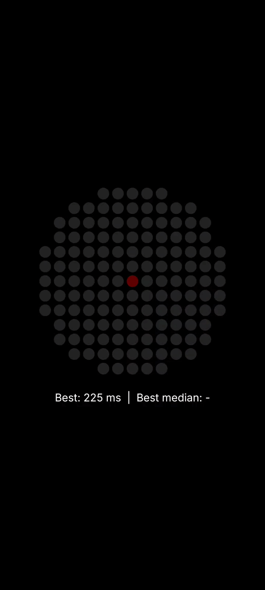

# Lights Out

A start-lights reaction game for the **Glyph Matrix** on the Nothing Phone (4a) Pro.

Five red bars light up one by one on the back of the phone, hold for a random moment, then go dark. Hit a volume key as fast as you can. Your reaction time appears on the matrix in milliseconds.

  

<table align="center">
  <tr>
    <td align="center"></td>
    <td align="center"></td>
  </tr>
  <tr>
    <td align="center">Reaction time on the Glyph Matrix</td>
    <td align="center">On-screen mirror and saved bests</td>
  </tr>
</table>

## Features

- **Start-lights sequence** on the 13×13 Glyph Matrix, mirrored live on screen
- **Random hold** (0.2–3.0 s) after the fifth light, so you can't time the rhythm
- **Jump-start detection** with a flashing ring and a haptic buzz
- **Anticipation filter**: presses under 100 ms don't count
- **Sessions of 5** valid starts, scored by **median** so one lapse doesn't ruin a run
- **Saved records**: best single time and best session median survive restarts
- Hand-built **3×5 pixel font** for numbers on the circular matrix

## Requirements

- Nothing Phone (4a) Pro (the code registers `Glyph.DEVICE_25111p`; it won't drive other models)
- Android 14 or later

## Install the APK

1. Download `LightsOut-v1.0.0.apk` from [Releases](../../releases).
2. Open it on your phone and allow installing from this source when asked.
3. Open **Lights Out** and hold the phone with the back facing you.

## How to play

| Matrix shows | Do this |
|---|---|
| Dim centre dot | Press a volume key to start |
| Red bars filling | Wait. Pressing now is a jump start |
| All dark | Press as fast as you can |
| Three digits | Your reaction time in ms |
| Digits + faint ring | Anticipated (under 100 ms), doesn't count |
| Digits + 5 bright dots | Your session median |

## Build from source

The Glyph Matrix SDK is **not included** in this repository because Nothing's licence does not permit redistributing it.

1. Clone this repo and open it in Android Studio.
2. Download `glyph-matrix-sdk-2.0.aar` from Nothing's [GlyphMatrix Developer Kit](https://github.com/Nothing-Developer-Programme/GlyphMatrix-Developer-Kit).
3. Place it at `app/libs/glyph-matrix-sdk-2.0.aar`.
4. Sync Gradle, connect your phone with USB debugging on, and press Run.

## Project structure

| File | Responsibility |
|---|---|
| `Frames.kt` | Draws every matrix picture: lights, ring, digits, progress dots |
| `StartLightsGame.kt` | Game rules, timing state machine, saved records |
| `MainActivity.kt` | Volume-key input, on-screen mirror, Glyph Matrix connection |

## Notes

- Reaction times include a small, unmeasured display delay, so they're comparable with each other, not with lab reaction tests.
- Volume keys only register while the app is open with the screen on.

## Disclaimer

Unofficial, non-commercial fan project. Not affiliated with or endorsed by Nothing Technology Limited. Built using Nothing's Glyph Matrix Developer Kit under its licence terms.
